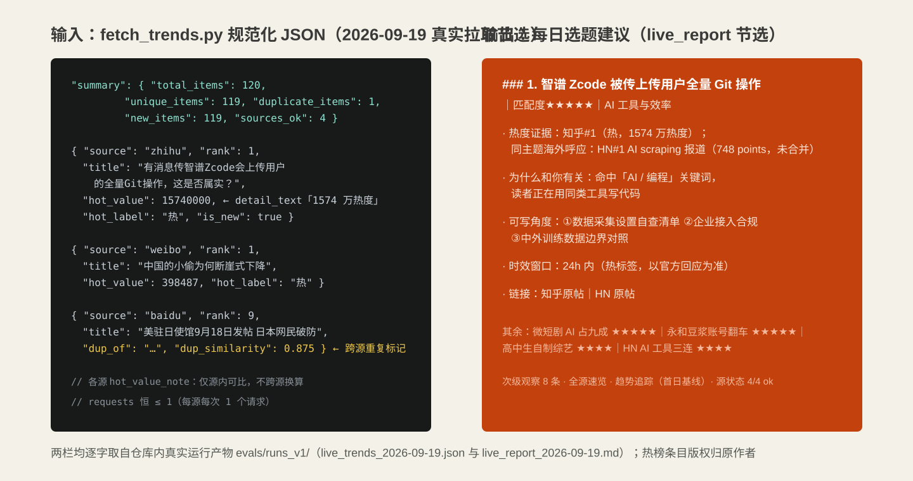
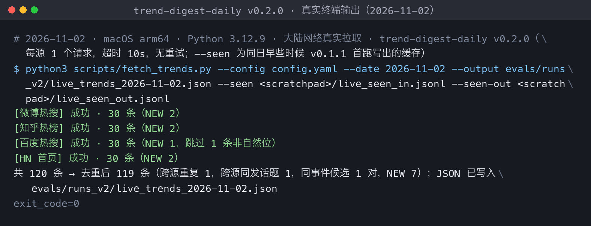
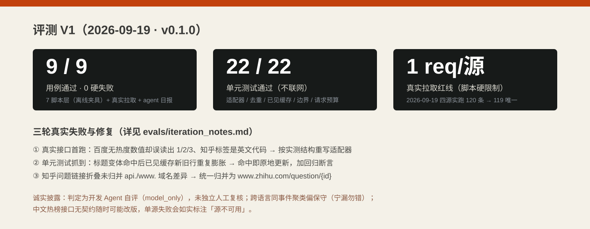

# 每日选题雷达 trend-digest-daily

  

自媒体每日选题雷达：早上自动汇总各平台公开热榜，去重聚类成一份选题建议清单。
不用再挨个 App 刷微博、知乎、百度、HN——跑一次脚本（每源只发 1 个请求），Agent 就把
重复的、口水的、与你领域无关的热点过滤掉，给你 3-5 张能直接动笔的选题卡，附热度证据、
切入角度和时效窗口。零依赖（Python 标准库）、零账号、数据全部落在本地。

## 使用场景

| 场景 | 你是谁 | 什么时候用 | 它帮你干什么 |
| --- | --- | --- | --- |
| 早上定选题 | 个人博主 / 公众号作者 | 每天开工前，不想逐个平台刷热榜 | 一份日报看清四平台热点：哪些跨源同发、哪些是新上榜（NEW）、哪些连续在榜 |
| 只看自己领域的热点 | 垂类博主（AI / 自媒体 / 职场…可自配） | 热点很多但多数与你无关 | 按你 config 里的领域关键词打分排序，无关热点降级到"次级观察" |
| 追热点时效 | 热点 / 蹭热点型账号 | 看到"爆""热"标签拿不准要不要跟 | 选题卡标注时效窗口（如 24h 内）与佐证（各源排名 + 标签） |
| 连续追踪一个话题 | 做深度解读的作者 | 想知道某话题是一日游还是持续发酵 | 已见缓存记录连续在榜天数（streak），连续 ≥2 天自动进"趋势追踪" |

不适合的场景：全站数据爬取、竞品数据分析、自动发文——它只读各平台公开热榜的标题与热度，
每源每次 1 个请求，不做爬虫，不代写不代发。

## 它解决什么问题

找选题的时间成本被从业者默认接受（手工 SOP 约每天 30-60 分钟搜集 + 30 分钟汇总），
付费产品也验证了意愿：BuzzSumo $199/月起、AnswerThePublic $20/月——但它们贵、按人头计费、
**中文热源缺位**；国内开源同类（newsnow 21.7k★、RSSHub 46.2k★、DailyHotApi 4.1k★）
都止步于"聚合展示"，没有"→选题卡"的最后一公里。本仓库只做这一步：**多源公开热榜 →
去重聚类 → 对照你的领域 → 每日选题建议**。

  

下面是 2026-09-19 真实运行（大陆网络，微博/知乎/百度/HN 各 1 个请求，120 条 → 去重 119）的真实终端截图：

  

## 能力与边界

| 能力 | 边界 |
| --- | --- |
| 六源适配器：微博/知乎/百度/HN 默认启用，Reddit/GitHub Trending 可选 | 中文源均为**无契约的公开端点，接口随时可能改版**；可选源直连可用性随网络环境波动（Reddit 两次实测均需代理，GitHub 同日两次一超时一可达）；单源挂了会在日报标注"源不可用"，不保证当日可用 |
| 标题去重：URL 归一 + 字符 2-gram Jaccard + difflib 双阈值；已见缓存记 NEW/连续在榜 | 跨语言、措辞差异大的同一事件不会自动合并，由 Agent 保守聚类（宁漏勿错） |
| 热度证据：各源排名 + 热/爆/新标签原样引用 | 热度口径互不可比（微博热度值/知乎万热度/HN points/百度无数值），跨源排序是 AI 建议非官方排名 |
| 纯 Python 标准库、离线夹具模式、同输入输出 sha256 一致 | 只读标题与公开热度数，不验证链接真伪、不转载正文；发布前请点开原帖核实 |

## 如何安装与使用

把本仓库放入你的 Agent 技能目录，然后把 `config.yaml` 改成你自己的领域关键词
（AI 工具 / 自媒体运营 / 职场成长只是示例，可增删），再直接对 Agent 说：

> "拉一下今天各平台的热榜，按我的领域出一份选题日报。"

Agent 会运行抓取脚本（每源 1 个请求，失败源自动降级），把热榜去重聚类，
按你的领域写成选题卡，落成一份 reports 日报。也可以只把它当命令行工具用，
参数、crontab 定时命令与评测复现见[维护文档](docs/usage.md)。无需任何 API 密钥，
断网可用离线夹具模式跑通全流程。

## 评测结果

V1 评测（2026-09-19，v0.1.0）：**9/9 用例通过，0 硬失败**；单元测试 22/22。
覆盖多源聚合、NEW/连续在榜增量、单源 500 错误隔离、空榜单、全源失败、确定性
（--offline 两次运行 sha256 一致）、Jaccard 去重边界、真实拉取红线（每源 requests=1）
与 agent 日报十类行为。

  

- 逐题判断：[judgments_v1.jsonl](evals/judgments_v1.jsonl)；机器汇总：[summary_v1.json](evals/summary_v1.json)
- 真实产物与哈希：[evals/runs_v1/](evals/runs_v1/)（含 2026-09-19 真实拉取 JSON 与日报）
- **诚实披露**：首屏终端截图与示例均来自 2026-09-19 的真实拉取（热榜条目版权归原作者，
  仅按标题与链接引用）；评测夹具为合成样本；判定为开发 Agent 自评（model_only），
  尚未独立人工复核；开发中三轮真实失败（百度热度字段误读、缓存重复膨胀、知乎链接未归并）
  的修复过程见[迭代记录](evals/iteration_notes.md)。

**2026-09-19 第二次联网回归（v0.1.1，与建仓首跑间隔数小时）**：四源（微博/知乎/百度/HN）全部
可用、结构与首跑完全一致，每源每跑仍恰 1 个请求；带 seen 连续两跑（间隔约 3 分钟）第一跑
120 条全量 NEW 基线、第二跑 116 条已见 + 3 条 NEW，缓存 119→122 行无重复膨胀，增量逻辑在
真实数据上成立。可选源降级如实标注：Reddit 两次实测均超时（报"源不可用"）；GitHub Trending
当日下午直连可达，但页面新增赞助链接致旧适配器混入 1 条 `/sponsors/explore` 假条目——已修
适配器（17/17 仓库全量解析）并加回归测试（单测增至 24/24）。产物与终端记录见
[evals/runs_v1/](evals/runs_v1/)（regression_2026-09-19_*）。

## 对标与定位

与 newsnow / RSSHub / DailyHotApi 等聚合工具的定位对比，以及"local-first、每源 1 请求、
不越权"的立场，见[对标文档](references/benchmarks.md)。

需求来源：自媒体需求雷达对公开信号的研究（problem_key `trend-digest-daily`，
需求被 $20-199/月付费产品与人工情报社群双侧验证）。

## 社区与许可

- 社区讨论：[LINUX DO](https://linux.do)
- 许可证：Apache License 2.0（见 [LICENSE](LICENSE)，第三方素材说明见 [NOTICE](NOTICE)）
