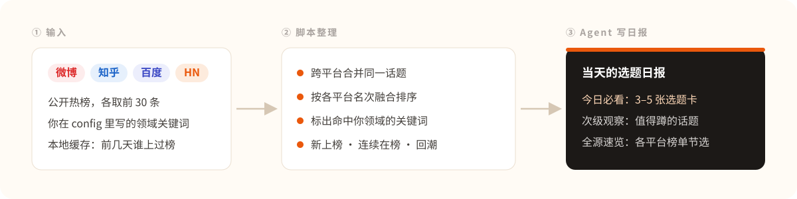

# 每日选题雷达

**每天早上一份选题日报：四个平台的热榜看一遍，挑出和你领域相关、今天就能动笔的 3–5 个选题。**

---

## 效果展示

下面是 2026-11-02 在中国大陆网络下的一次真实运行。四个热榜各发 1 个请求，共拿到 120 条，合并跨平台重复后剩 119 条，百度的置顶条目不计入名次：

Agent 拿这份数据写成当天的选题日报。下面是日报里的第一张选题卡，原文照录：

> **1. 微软裁员：6 万人可自愿离职，Copilot 部门也没躲过 ｜匹配度★★★｜职场与个人成长 × AI 工具与效率**
> - **热度证据**：知乎#9（197 万热度）· 知乎#14（热，144 万热度）
> - **为什么和你有关**：domain_hits 命中「Copilot」（AI 工具）和「职场」「裁员」（职场）；大厂 AI 业务也在裁员，AI 从业者和打工人两类读者都会关心。
> - **可写角度**：①AI 部门也裁员，说明了什么：从 Copilot 看大厂 AI 投入的取舍；②「自愿离职方案」跟裁员有什么不一样，碰到了该怎么算账；③大厂上班 vlog 和真实职场的差距，以及怎么判断一家公司的真实工作强度。
> - **时效窗口**：3 天内（热标签；以微软官方口径为准，不要引用 vlog 里的说法当事实）

这份日报一共 5 张选题卡，外加次级观察和各平台榜单速览，[可以看全文](./evals/runs_v2/live_report_2026-11-02.md)。文中 6 个链接、44 处名次和热度数字都用脚本对照当天数据核过一遍，没有对不上的。热榜条目版权归原作者，这里只引用标题和链接。

## 它怎么工作

脚本负责抓取和算数，Agent 负责判断和写作。日报里的名次、热度数字和链接只能引用当天抓到的数据，写完后还可以用脚本逐条回核。

## 它能做什么

- **四个热榜一次看完**：默认抓微博、知乎、百度和 Hacker News 首页，GitHub Trending 可以选配。
- **同一件事只出现一次**：不同平台上的同一话题会合并；说法差得多的，脚本先标成候选，再由 Agent 确认。
- **排序靠名次，不比热度数**：各平台的热度口径不一样，所以只用各自的名次来排，多个平台同时在榜的话题排在前面。
- **只挑你关心的领域**：在 config.yaml 里写上你的领域和关键词，选题卡只从命中的话题里挑，其余放进「次级观察」。
- **知道话题新不新**：本地缓存会记下哪些是新上榜、连续上榜了几天、断了几天又回来的。
- **选题卡拿来就能写**：每张卡都写了热度证据、和你有什么关系、几个切入角度、时效窗口和原帖链接。

## 适合谁

| 你是谁 | 典型场景 | 它帮你做什么 |
| --- | --- | --- |
| 公众号、博客作者 | 早上定今天写什么 | 一份日报看完四个平台，不用挨个刷 |
| 垂类博主（AI、职场、自媒体……） | 只想看自己领域的事 | 按你的关键词筛出相关话题，写好切入角度 |
| 追热点的账号 | 拿不准还要不要追 | 每张卡都写了时效窗口：24 小时内、3 天内还是长尾 |
| 做深度解读的作者 | 跟踪一个话题的走势 | 记录连续在榜天数，标出断了又回来的话题 |

## 如何安装

把这个仓库的 GitHub 地址发给你正在用的 Claude Code、Codex 或其他支持 Skills 的 Agent，告诉它：

> 请把这个仓库安装成 Skill，装好后确认它出现在可用的 Skills 里。

Agent 会把整个目录放进自己的 Skills 位置，重新打开会话就能用。也可以下载压缩包，把解压后的整个文件夹放进 Skills 目录。注意不要只拿走 SKILL.md，抓取脚本要一起放。

电脑上有 Python 3 就够了，不用装别的依赖，也不用注册账号或申请 API Key。

## 如何使用

先打开 config.yaml，把示例里的「AI 工具」「自媒体运营」「职场成长」换成你自己的领域和关键词。不改也能用，这时出的是不分领域的通用版。然后直接跟 Agent 说：

> 拉一下今天各平台的热榜，按我的领域出一份选题日报。

> 只看 AI 相关的，给我三个今天能写的选题，每个附上原帖链接。

> 最近连续上榜好几天的话题有哪些？哪些是断了又回来的？

Agent 会运行抓取脚本，读结果，合并同一事件，写好选题卡，再存成当天的日报。手动运行、命令行参数和每天定时跑的方法见 [使用文档](./docs/usage.md)。

## 对标与参考

| 项目 | 它做到哪一步 |
| --- | --- |
| [TrendRadar](https://github.com/sansan0/TrendRadar) | 中文热点监控和推送，按关键词筛选 |
| [newsnow](https://github.com/newsnext/newsnow)、[DailyHotApi](https://github.com/imsyy/DailyHotApi) | 多平台热榜聚合和展示 |
| [BuzzSumo](https://buzzsumo.com/)、[Google Trends](https://trends.google.com/) | 看话题的上升速度，不只看总量 |

这些工具大多停在「把热榜聚到一起」。本项目往前多走一步，直接给出选题卡；而且不用部署服务，每个源每天只发 1 个请求。完整的对比、出处和排序方法依据见 [references/benchmarks.md](./references/benchmarks.md)。

## 效果怎么验证

评测分三部分：真实拉取四个热榜，用脚本核对 Agent 写的日报里每个链接和数字是否都来自当天数据，再用离线用例检查去重、缓存、降级和排序。题集、量表和逐项结果见 [评测说明](./evals/README.md)。

## 边界与注意事项

- **只读公开信息**：只取各平台公开热榜的标题、名次、热度数和链接，不登录，不爬全站，也不自动发稿。
- **接口可能失效**：微博、知乎、百度用的是没有官方承诺的公开接口，HN 和 GitHub 靠解析网页，改版后就可能抓不到。某个源挂了，日报会注明，其他源照常出。Reddit 已经不能匿名访问，基本用不了。
- **合并宁漏勿错**：说法差得多的同一事件只标成候选，中英文之间的同一事件要靠 Agent 判断。
- **关键词别太宽**：「工作」这类词会带来很多弱相关命中，换成更具体的词效果更好。
- **只给建议，不核实事实**：发布前请点开原帖，自己确认一遍。

## 社区

[**LINUX DO — 中文开发者社区**](https://linux.do/)

欢迎来分享你的领域配置、日报样例和遇到的数据源问题。

## 许可

本项目采用 [Apache License 2.0](./LICENSE)，第三方说明见 [NOTICE](./NOTICE)。热榜内容版权归各平台和原作者。
