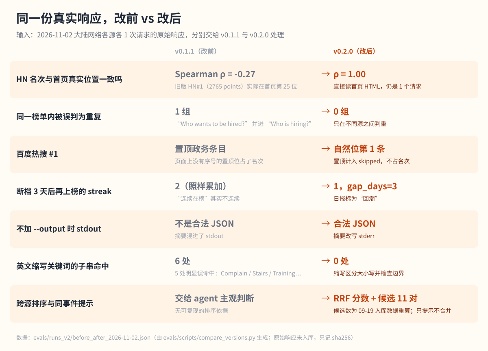

# 每日选题雷达 trend-digest-daily

  

给自媒体作者用的每日选题助手：早上拉一遍微博、知乎、百度、Hacker News 的公开热榜，
合并重复话题、按跨平台热度排序、对照你配置的领域关键词，交给你 3-5 张能直接动笔的选题卡，
每张都写明热度证据、切入角度和时效窗口。不用账号、不用 API Key，数据都存在你自己电脑上。

## 当前版本真实跑出来的效果

2026-11-02 在中国大陆网络下用 v0.2.0 真实拉取，四个源各 1 个请求，120 条去重后 119 条，
百度的置顶条目被排除出名次。下图是那次运行的终端输出（逐字渲染，过长的行折行显示）：

  

Agent 拿这份数据写出的日报（[全文](evals/runs_v2/live_report_2026-11-02.md)，其中 6 个链接、44 处名次和热度数字
都由脚本回核过，[核对结果](evals/runs_v2/report_check_2026-11-02.json)）。下面是第一张选题卡，原文照录：

> **1. 微软裁员：6 万人可自愿离职，Copilot 部门也没躲过 ｜匹配度★★★｜职场与个人成长 × AI 工具与效率**
> - **热度证据**：知乎#9（197 万热度）· 知乎#14（热，144 万热度）
> - **为什么和你有关**：domain_hits 命中「Copilot」（AI 工具）和「职场」「裁员」（职场）；大厂 AI 业务也在裁员，AI 从业者和打工人两类读者都会关心。
> - **可写角度**：①AI 部门也裁员，说明了什么：从 Copilot 看大厂 AI 投入的取舍；②「自愿离职方案」跟裁员有什么不一样，碰到了该怎么算账；③大厂上班 vlog 和真实职场的差距，以及怎么判断一家公司的真实工作强度。
> - **时效窗口**：3 天内（热标签；以微软官方口径为准，不要引用 vlog 里的说法当事实）

热榜条目版权归原作者，这里只引用标题和链接。

### 这一版改了什么：同一份真实数据，改前改后对比

v0.2.0 是对照同类产品、开源项目和排序方法论做了一轮逻辑审查之后的版本。为了看清改动效果，
把 2026-11-02 同一时刻抓到的原始响应冻结下来，分别交给旧版 v0.1.1 和新版 v0.2.0 处理：

  

影响最大的是第一行。旧版的 HN 数据来自 Algolia 接口，它按点赞数排序，不是首页顺序，
所以旧日报里的「HN#1」其实是首页第 25 位的一条 44 小时前的老帖。新版直接读 HN 首页，名次就是首页上的位置。
每一项的数据都在 [before_after_2026-11-02.json](evals/runs_v2/before_after_2026-11-02.json)，
问题清单、依据和改与不改的理由在 [迭代记录](evals/iteration_notes.md)。

## 适合谁、什么时候用

| 场景 | 你是谁 | 它帮你干什么 |
| --- | --- | --- |
| 早上定选题 | 个人博主、公众号作者 | 一份日报看完四个平台：哪些话题跨平台同时在榜、哪些是新上榜、哪些连续在榜 |
| 只看自己领域 | 垂类博主（AI、自媒体、职场等，可以自己配） | 按你的关键词标出命中，选题卡只从命中的话题里挑，其余放进「次级观察」 |
| 拿不准要不要追 | 追热点的账号 | 选题卡写明时效窗口：带「爆/热」标签的建议 24 小时内跟，名次在上升的标「上升中」 |
| 跟踪一个话题 | 做深度解读的作者 | 记录连续在榜天数；断了几天又回来的标「回潮」 |

不适合：全站爬取、竞品数据分析、自动写稿发稿。它只读各平台公开热榜的标题、名次和公开热度数，每个源每次只发 1 个请求。

## 能做什么，做不到什么

| 能力 | 边界 |
| --- | --- |
| 默认四个源：微博、知乎、百度、HN 首页；可选 GitHub Trending | 中文源都是没有官方承诺的公开接口，随时可能改版；某个源挂了，日报会写「源不可用」，其他源照常 |
| 排序只用各平台自己的名次（倒数排名融合 RRF），跨平台同时上榜的话题排在前面 | 各平台热度数值口径不同，绝不相加或比较；排序是建议，不是官方排名 |
| 只在不同平台之间判重复；措辞差异大的同一事件标为「候选」，由 Agent 确认后再合并 | 中英文之间的同一事件不会自动合并，宁可漏并也不误并 |
| 本地缓存记录新上榜、连续在榜、名次变化和回潮 | 每天跑一次，名次变化是按天算的粗粒度信号，不是实时速度 |
| 领域匹配由脚本完成：中文按字面，英文缩写区分大小写（命中 OpenAI、ChatGPT，不会命中 Complain） | 关键词太宽泛（比如「工作」）会带来弱相关命中，日报会说明并降级 |
| Reddit 适配器还在 | Reddit 从 2026 年 5 月起拒绝匿名访问，2026-11-02 实测返回 403，基本用不了 |

## 对标与参考

这一版调研了国内外同类产品、开源项目和排序方法，详细的对比表、出处链接和差距分析见
[references/benchmarks.md](references/benchmarks.md)。简单说：

- **TrendRadar**（GitHub 6.3 万 star 的中文热点监控工具）也只用名次来排序，不比较各平台的热度数值，
  这和本项目的做法一致；但它的关键词是子串匹配，会把「AI」匹配进「Complain」，本项目改成了按边界匹配。
- **newsnow、DailyHotApi** 抓 HN 时都直接读首页页面，newsnow 抓百度时还会去掉置顶条目。本项目原来用的
  Algolia 接口按点赞数排序，这次改成读首页，并同样排除百度置顶。
- **BuzzSumo、Google Trends** 都看「增长速度」而不是总量。本项目拿不到分享数和搜索量，只能用名次变化近似，
  文档里写明了这一点。
- 方法依据：跨平台排序用 Cormack 等人 2009 年提出的倒数排名融合（RRF），找同一事件用 Broder 1997 年的包含度。

和这些工具相比，本项目的不同在于：不需要部署服务，每个源每天只发 1 个请求，并且做到「热榜 → 选题卡」这一步，
而不是停在聚合展示。

## 如何安装

把这个仓库的 GitHub 地址发给你正在用的 Claude Code、Codex 或其他支持 Skills 的 Agent，告诉它：

> 请把这个仓库安装成 Skill，装好后确认它出现在可用的 Skills 里。

Agent 会把整个目录放进自己的 Skills 位置，重新打开会话即可。也可以下载压缩包，把解压后的整个文件夹放进
Skills 目录；不要只拿 SKILL.md，抓取脚本和规范文件要一起放。仓库里也带了一个安装脚本，用法见[使用文档](docs/usage.md)。

只需要电脑上有 Python 3，不用装任何依赖，不用注册账号，不用 API Key。

## 如何使用

先把仓库里的 config.yaml 改成你自己的领域和关键词（示例里的「AI 工具」「自媒体运营」「职场成长」可以随意增删），
然后直接对 Agent 说：

> 拉一下今天各平台的热榜，按我的领域出一份选题日报。

> 只看 AI 相关的，给我三个今天能写的选题，每个附上原帖链接。

> 最近连续上榜好几天的话题有哪些？哪些是断了又回来的？

Agent 会运行抓取脚本，读结果，合并同一事件，按你的领域写选题卡，存成一份当天的日报。
不配置 config.yaml 也能用，这时输出的是不分领域的通用版。命令行参数、每天定时运行和评测复现见[使用文档](docs/usage.md)。

## 评测结果

当前版本 v0.2.0，2026-11-02 评测，三层证据：

| 层 | 测什么 | 样本 | 结果 | 证据 |
| --- | --- | --- | --- | --- |
| 改前改后对比 | 同一份真实响应交给 v0.1.1 和 v0.2.0 | 5 个源 135 条（含 GitHub Trending） | 见上方对比图，7 项全部按预期变化 | [before_after_2026-11-02.json](evals/runs_v2/before_after_2026-11-02.json) |
| 真实拉取 | 四个默认源是否可用、是否每源只发 1 个请求 | 1 次真实运行，120 条 | 4/4 成功，每源 1 个请求；另测可选源：GitHub 15 条成功，Reddit 403 | [live_trends](evals/runs_v2/live_trends_2026-11-02.json)、[终端记录](evals/runs_v2/live_2026-11-02_terminal.txt)、[可选源](evals/runs_v2/live_optional_2026-11-02.json) |
| Agent 日报 | 日报引用的链接、名次、热度数字是否都来自当天数据 | 1 份日报，6 个链接、44 处引用 | 0 处对不上 | [日报](evals/runs_v2/live_report_2026-11-02.md)、[核对结果](evals/runs_v2/report_check_2026-11-02.json) |
| 脚本行为 | 去重、缓存、降级、排序、关键词规则等 | 13 个离线用例（合成数据） | 13/13 通过 | [case_results_v2.json](evals/runs_v2/case_results_v2.json) |

量表、题集和逐题判断见 [evals/README.md](evals/README.md)。几点说明：

- 判定由开发用的 Agent 自评，没有独立人工复核。15/15 的通过率只说明没有违反量表，不代表选题质量分。
- 对比用的原始响应里有第三方摘要和用户名，没有放进仓库，只记录了校验值；别人要复现需要自己当天重新抓取。
- 上一版（v0.1.x，2026-09-19）的评测证据原样保留在 [runs_v1](evals/runs_v1/)，其中日报里的「HN#N」是点赞数顺序，不是首页位置。

## 失败案例与边界

- **旧版 HN 名次是错的**：v0.1.x 的日报里「HN#1」其实是点赞数第一，2026-11-02 那条在首页第 25 位。v0.2.0 已修。
- **同一事件说法差太多时合不起来**：比如微博「郭士强 下课」和知乎「中国男篮不敌日本后，网友称让郭士强下课」，
  脚本只能标成候选，最后由 Agent 判断；中英文之间的同一事件则完全靠 Agent。
- **跨平台重合少的日子排序区分度低**：2026-11-02 四个平台只有 1 个话题同时在榜，各平台第 1 名的排序分数一样，
  这时主要靠领域匹配和热度标签来挑。
- **宽泛关键词会带来弱相关**：示例配置里的「工作」会命中很多普通问句，建议换成更具体的词。
- **连续在榜和名次变化还没在真实多日数据上验证过**：本轮只用合成缓存和模拟日期测过。
- **接口会变**：微博、知乎、百度都是公开但没有承诺的接口；HN 首页和 GitHub Trending 靠解析网页，页面改版就会失效。Reddit 已经不能匿名访问。
- 它只给建议，不替你核实事实。发布前请点开原帖确认。

## 社区与许可

- 社区讨论：[LINUX DO](https://linux.do/)
- 许可证：Apache License 2.0（见 [LICENSE](LICENSE)，第三方说明见 [NOTICE](NOTICE)）
